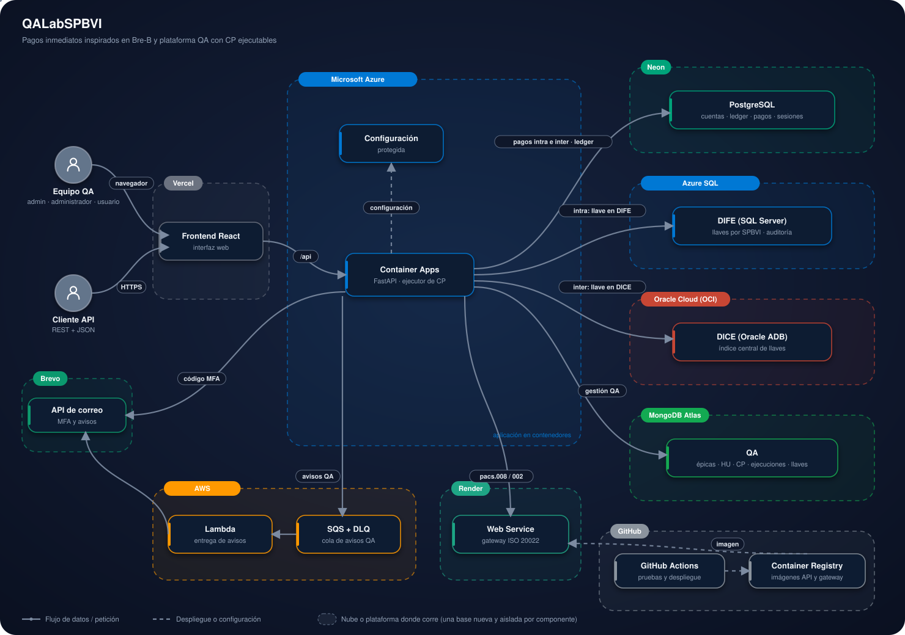

# QALabSPBVI · Laboratorio de pagos inmediatos

<p>
  <a href="https://qalabspbvi-prod.vercel.app"></a>
  <a href="https://frontend-nine-topaz-99.vercel.app"></a>
  <a href="https://d4i3vsgw7xwmh.cloudfront.net"></a>
</p>


> 📘 **[Manual de usuario](docs/MANUAL.md)**: cómo usar cada pantalla, paso a paso y con imágenes.

## Contenido

1. [Presentación](#1-presentación)
2. [Funcionalidades](#2-funcionalidades)
3. [Arquitectura](#3-arquitectura)
4. [Estructura del proyecto](#4-estructura-del-proyecto)
5. [Instalación para pruebas](#5-instalación-para-pruebas)
6. [Autor y licencia](#6-autor-y-licencia)

---

## 1. Presentación

Laboratorio simulado de pagos inmediatos interoperables, inspirado en los esquemas nacionales de
pagos inmediatos con llaves. Sirve para practicar y mostrar aseguramiento de calidad automatizado:
pruebas de API REST con JSON, mensajería ISO 20022 de laboratorio y recorridos E2E.

Es un proyecto de portafolio: **no se conecta a ninguna infraestructura real de pagos** y la
liquidación es una simulación.

- **Qué hace:** registra llaves (celular, correo, documento, alfanumérica y código de comercio) en
  el directorio de cada entidad (DIFE) y en el central (DICE), y procesa pagos entre cuentas de la
  misma entidad o de entidades distintas, con idempotencia y límite por operación.
- **Para el equipo QA:** una plataforma tipo Jira (épica → HU → CP, tareas, bugs y fixes) en la que
  cada caso de prueba es una solicitud REST con JSON que se ejecuta con un clic y muestra la
  solicitud, la respuesta y el veredicto.
- **Cómo probarlo:** entra a la [demo](https://qalabspbvi-prod.vercel.app) y pulsa **Crear cuenta**.
  Cuando te asocien a una épica, podrás ejecutar sus casos.

## 2. Funcionalidades

**Llaves y pagos**
- Directorio de llaves con unicidad global y ciclo de vida completo (asignación de titular,
  suspensión, reactivación y eliminación).
- Pagos dentro de la misma entidad y entre entidades, con liquidación simulada, idempotencia,
  devoluciones, cancelaciones y notificaciones.
- Mensajes ISO 20022 de laboratorio (pacs, camt y pain) validados contra esquemas propios.

**Pagos con QR**
- QR en formato EMVCo: estático, estático con monto y cobro dinámico de un solo uso.
- Generación y lectura con la cámara, desde una imagen o pegando su contenido; un QR alterado se
  rechaza sin mover dinero.

**Plataforma QA**
- Épicas, HU, CP, tareas, bugs y fixes con permisos por rol.
- CP ejecutables y versionados, con validación del contrato de cada respuesta y reintentos ante
  cortes de red.
- Importación de programas completos; incluye un programa ISO 20022 de 60 CP.
- Avisos por correo a los integrantes de la épica.

**Resiliencia y trazabilidad**
- Simulador de fallos de red (latencia, tiempos de espera, errores y cortes) para pruebas de
  resiliencia.
- Registro de cada solicitud con identificador de correlación y exportación CSV.

**Acceso e interfaz**
- Registro abierto y verificación en dos pasos obligatoria (app autenticadora o código por correo),
  con recuperación de contraseña y del autenticador.
- Se instala como aplicación, con tema claro y oscuro; adaptable a celular, tablet y computador.

## 3. Arquitectura

<p align="center">
  
</p>

| Capa | Tecnología |
|---|---|
| API | Python 3.13 y FastAPI, organizada por dominios |
| Interfaz | React, TypeScript y Vite; se instala como aplicación |
| Datos | Una base de datos distinta por dominio (cinco motores) |
| Mensajería | ISO 20022 de laboratorio con esquemas propios |
| Pruebas | pytest en cada cambio; pruebas E2E diarias con Playwright |
| Despliegue | Contenedores que se publican solos desde GitHub |

## 4. Estructura del proyecto

```
app/
├── api/          Rutas HTTP y esquemas
├── core/         Configuración, seguridad y correo
├── db/           Modelos y sesiones
└── domains/      Autenticación, llaves, pagos, ISO 20022, QR y QA
services/         Gateway ISO 20022 y entrega de avisos
qa_programs/      Programas de prueba importables y plantillas
tests/            Pruebas del backend
web/              Aplicación web y pruebas E2E
docs/             Manual de usuario y diagramas
```

## 5. Instalación para pruebas

1. Requisitos: Python 3.13 y Node.js 24. En local, la API puede usar bases temporales para probar.
2. Instala:

   ```bash
   python -m venv .venv
   .venv\Scripts\Activate.ps1        # Windows
   python -m pip install -e ".[dev,postgres]"
   cp .env.example .env
   cd web && npm install
   ```

3. Completa `.env` con tus propios valores, siguiendo sus comentarios (ese archivo no se sube al
   repositorio).
4. Arranca la API con `uvicorn app.main:app --reload` y la web con `npm run dev` (desde `web/`).
5. Pruebas: `python -m pytest -q` y, para E2E, `npm run test:e2e` desde `web/`.

## 6. Autor y licencia

**Luis F. A.** · [GitHub](https://github.com/lariasca1994) · [LinkedIn](https://linkedin.com/in/lfac1)

Contacto: Telegram [@lfac6](https://t.me/lfac6) · WhatsApp [@carraian160](https://wa.me/carraian160) ·
[ariascluisf@hotmail.com](mailto:ariascluisf@hotmail.com)

Licencia: MIT.
