# 📘 Manual de usuario · Laboratorio de pagos inmediatos (QALabSPBVI)

## 1. Portada

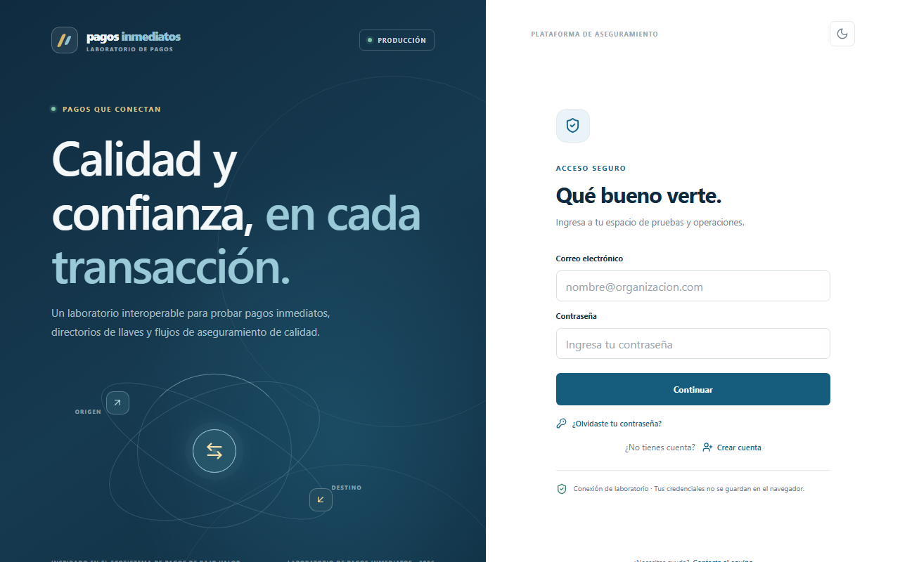

| | |
|---|---|
| **Producto** | Laboratorio de pagos inmediatos (QALabSPBVI) |
| **Documento** | Manual de usuario |
| **Versión** | 2.0 · noviembre de 2026 |
| **Dirigido a** | Equipos de aseguramiento de calidad (QA) y personas que prueban APIs de pagos |
| **Dirección** | [Laboratorio de pagos inmediatos](https://qalabspbvi-prod.vercel.app) |
| **Autor** | Luis F. A. |

## Contenido

1. [Portada](#1-portada)
2. [Introducción](#2-introducción)
3. [Objetivo](#3-objetivo)
4. [Alcance](#4-alcance)
5. [Acceso al sistema](#5-acceso-al-sistema)
6. [Pantalla principal](#6-pantalla-principal)
7. [Navegación](#7-navegación)
8. [Funcionalidades](#8-funcionalidades)
9. [Gestión de perfil](#9-gestión-de-perfil)
10. [Mensajes frecuentes](#10-mensajes-frecuentes)
11. [Preguntas frecuentes](#11-preguntas-frecuentes)
12. [Glosario](#12-glosario)

---

## 2. Introducción

El **Laboratorio de pagos inmediatos** simula un ecosistema de pagos con llaves (celular, correo,
documento, alfanumérica o código de comercio) entre entidades financieras llamadas **SPBVI**. Sirve
para practicar aseguramiento de calidad: cada caso de prueba es una solicitud a la API que se ejecuta
con un clic y muestra la respuesta y su veredicto.

Es un entorno de laboratorio: **no mueve dinero real** ni se conecta a ninguna red de pagos.

Este manual explica cada pantalla, paso a paso y con imágenes.

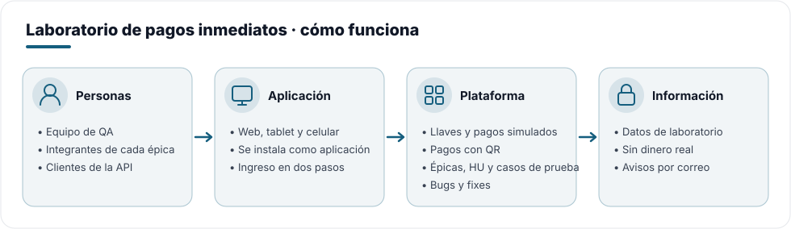

## 3. Objetivo

Que cualquier persona del equipo de QA pueda, sin conocimientos técnicos:

- Crear su cuenta e ingresar de forma segura.
- Registrar llaves, hacer pagos y cobrar con QR en el laboratorio.
- Consultar y ejecutar los casos de prueba de las épicas en las que participa.
- Reportar y hacer seguimiento a los bugs.

## 4. Alcance

**Incluye:** registro e ingreso con verificación en dos pasos, gestión de llaves, pagos entre
cuentas de la misma entidad o de entidades distintas, pagos con QR, épicas con historias de usuario
(HU), casos de prueba (CP) y tareas, bugs y fixes, y uso en celular, tablet y computador.

**No incluye:** dinero ni cuentas reales.

**Qué necesitas:** un navegador actualizado, conexión a internet y un correo propio. Para ejecutar
casos de prueba, un administrador debe asociarte a una épica.

## 5. Acceso al sistema

### 5.1 Crear una cuenta

En el inicio de sesión pulsa **Crear cuenta**.

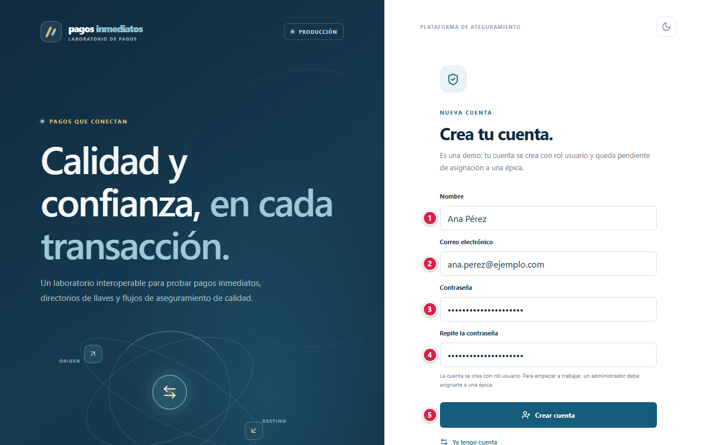

| # | Campo | Qué escribir |
|:-:|---|---|
| 1 | Nombre | Tu nombre |
| 2 | Correo electrónico | Un correo al que tengas acceso |
| 3 | Contraseña | Mínimo 12 caracteres |
| 4 | Repite la contraseña | La misma contraseña |
| 5 | Crear cuenta | Crea la cuenta con rol usuario; empiezas a trabajar cuando te asocien a una épica |

### 5.2 Iniciar sesión

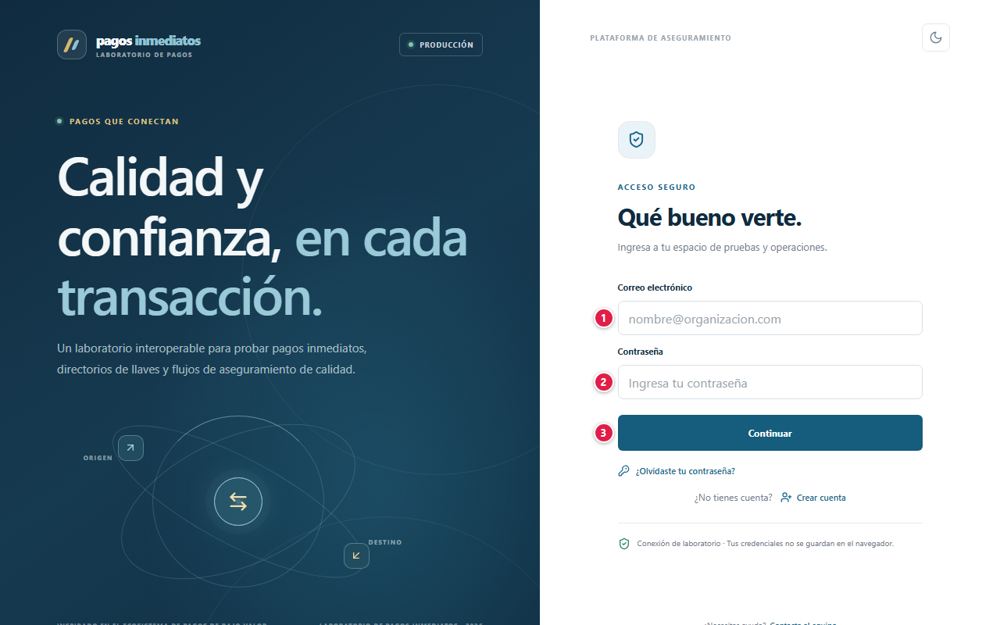

| # | Elemento | Qué hace |
|:-:|---|---|
| 1 | Correo electrónico | El correo de tu cuenta |
| 2 | Contraseña | Tu contraseña |
| 3 | Continuar | Comprueba tus datos y pide el código de tu segundo factor |

### 5.3 Verificación en dos pasos

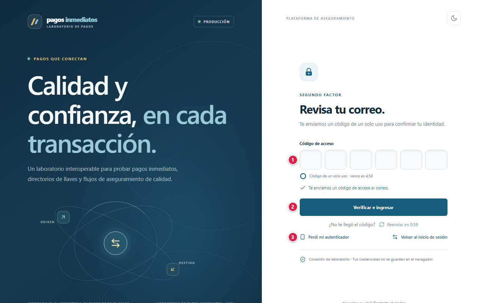

| # | Elemento | Qué hace |
|:-:|---|---|
| 1 | Código de acceso | Los 6 dígitos que llegan a tu correo (o los de tu app autenticadora) |
| 2 | Verificar e ingresar | Confirma el código y abre el laboratorio |
| 3 | Perdí mi autenticador | Te envía un código al correo de tu cuenta para configurar una app nueva |

Si el código no llega, **Reenviar** pide otro. Desde **Seguridad** (el escudo junto a tu nombre)
puedes agregar una app autenticadora y elegir cuál método se pide por defecto.

### 5.4 Recuperar la contraseña

En el inicio de sesión pulsa **¿Olvidaste tu contraseña?**.

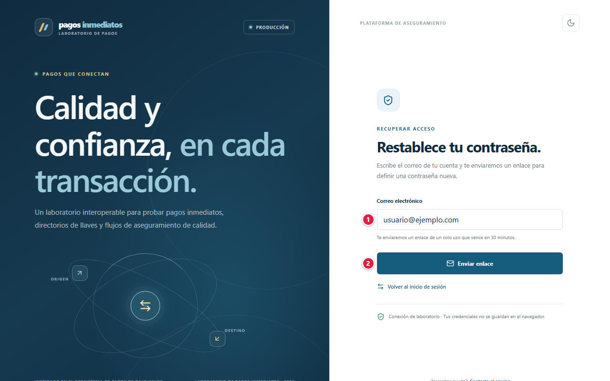

| # | Elemento | Qué hace |
|:-:|---|---|
| 1 | Correo electrónico | El correo de tu cuenta |
| 2 | Enviar enlace | Envía un enlace de un solo uso para crear una contraseña nueva (vence en 30 minutos) |

## 6. Pantalla principal

El **Resumen** muestra el avance de tus épicas y tus tareas pendientes.

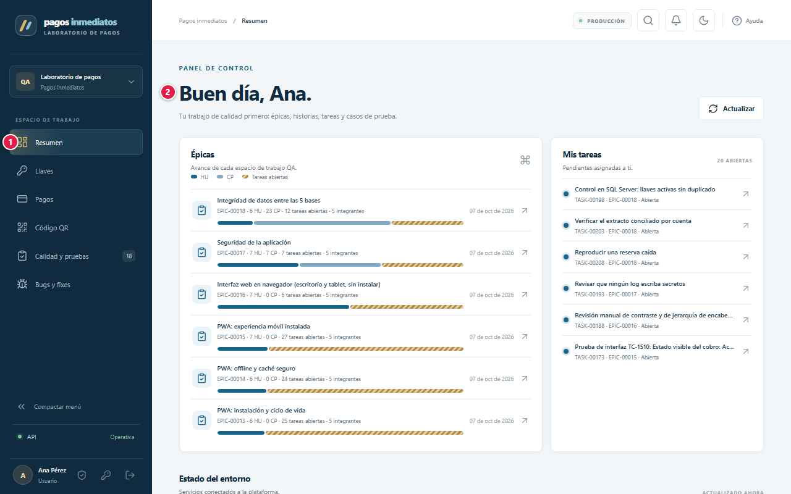

| # | Elemento | Qué hace |
|:-:|---|---|
| 1 | Menú | Lleva a Resumen, Llaves, Pagos, Código QR, Calidad y pruebas, y Bugs y fixes |
| 2 | Resumen | Épicas con su avance (HU, CP y tareas abiertas) y **Mis tareas** asignadas a ti |

## 7. Navegación

En el computador el menú está a la izquierda; **Compactar menú** lo reduce a íconos. Abajo están tu
nombre, **Seguridad**, **Cambiar contraseña** y **Cerrar sesión**. Arriba están la búsqueda, los
avisos, el tema claro u oscuro y la ayuda. En la tablet y en el celular el menú pasa a una barra
inferior; **Más** abre las secciones que no caben.

| Tablet en vertical | Celular |
|:-:|:-:|
| 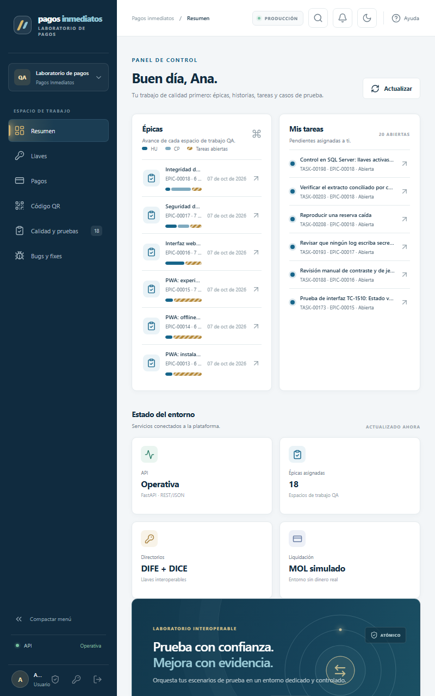 | 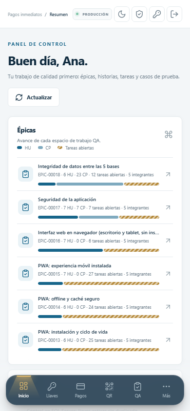 |

## 8. Funcionalidades

### 8.1 Crear: llaves, pagos y cobros con QR

**Llaves.** En **Registrar llave** das de alta una llave en el directorio de su entidad y en el
central:

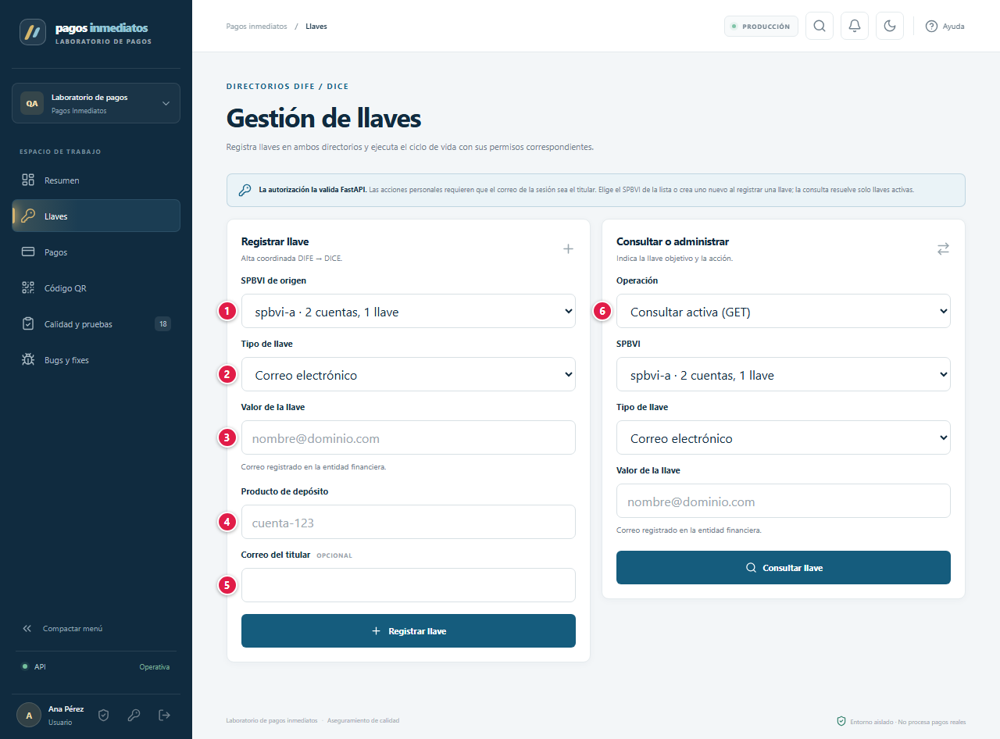

| # | Campo | Qué escribir |
|:-:|---|---|
| 1 | SPBVI de origen | La entidad donde se registra la llave |
| 2 | Tipo de llave | Celular, correo, documento, alfanumérica o código de comercio |
| 3 | Valor de la llave | La llave, en el formato de su tipo |
| 4 | Producto de depósito | La cuenta a la que llegan los pagos |
| 5 | Correo del titular | Opcional: quién es dueño de la llave |
| 6 | Operación | En **Consultar o administrar**: consultar, suspender, reactivar o eliminar una llave |

**Pagos.** Primero crea una cuenta de laboratorio y luego envía el pago:

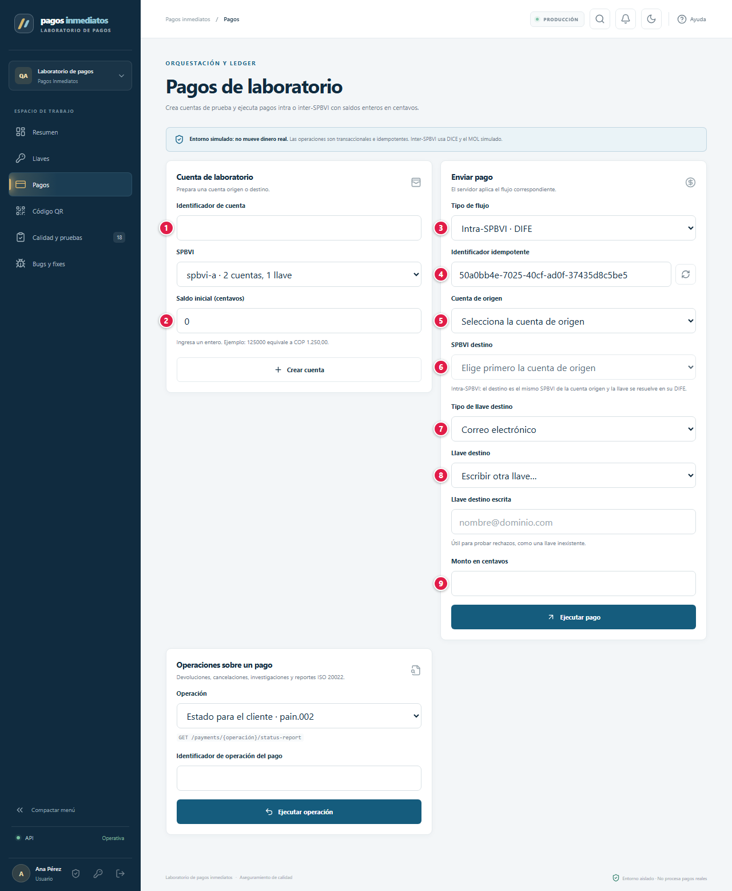

| # | Campo | Qué escribir |
|:-:|---|---|
| 1 | Identificador de cuenta | Un nombre para la cuenta de prueba |
| 2 | Saldo inicial (centavos) | El saldo, en centavos (125000 = $ 1.250,00) |
| 3 | Tipo de flujo | Dentro de la misma entidad o entre entidades |
| 4 | Identificador idempotente | Se genera solo; repetir el mismo pago con el mismo identificador no lo duplica |
| 5 | Cuenta de origen | La cuenta que paga |
| 6 | SPBVI destino | La entidad que recibe |
| 7 | Tipo de llave destino | El tipo de llave de quien recibe |
| 8 | Llave destino | Elige una llave o escribe otra (útil para probar rechazos) |
| 9 | Monto en centavos | El valor del pago |

**Cobros con QR.** En **Código QR** generas el QR que la otra persona escanea:

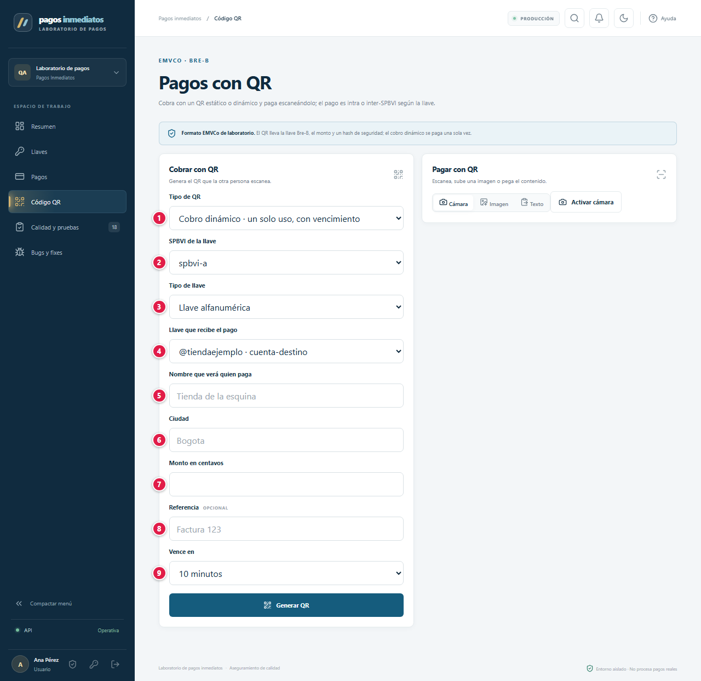

| # | Campo | Qué escribir |
|:-:|---|---|
| 1 | Tipo de QR | Estático, estático con monto o cobro dinámico de un solo uso |
| 2 | SPBVI de la llave | La entidad de la llave que cobra |
| 3 | Tipo de llave | El tipo de la llave que recibe el pago |
| 4 | Llave que recibe el pago | La llave que cobra |
| 5 | Nombre que verá quien paga | El nombre del comercio |
| 6 | Ciudad | La ciudad del comercio |
| 7 | Monto en centavos | El valor (en el QR estático lo elige quien paga) |
| 8 | Referencia | Opcional, por ejemplo el número de factura |
| 9 | Vence en | Cuánto dura el cobro dinámico |

**Pagar con QR**, a la derecha, lee el código con la cámara, desde una imagen o pegando su
contenido.

### 8.2 Consultar: épicas, historias y casos de prueba

En **Calidad y pruebas** eliges la épica y ves sus integrantes, sus HU y sus CP. **JSON** muestra la
solicitud del caso y **Ejecutar** la envía a la API y muestra la respuesta y el veredicto.

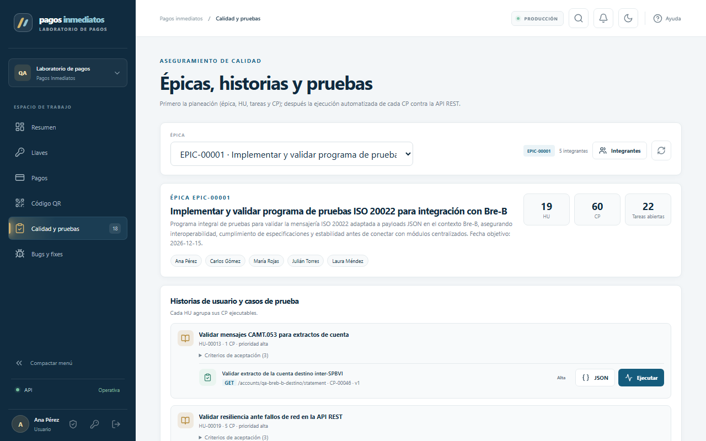

### 8.3 Modificar: bugs y fixes

En **Bugs y fixes** sigues los defectos de la épica: abiertos, asignados, en fix, listos para
retest, cerrados y reabiertos. Un bug se reporta desde una ejecución fallida, se asigna a un
integrante, se registra su fix y se cierra con el retest.

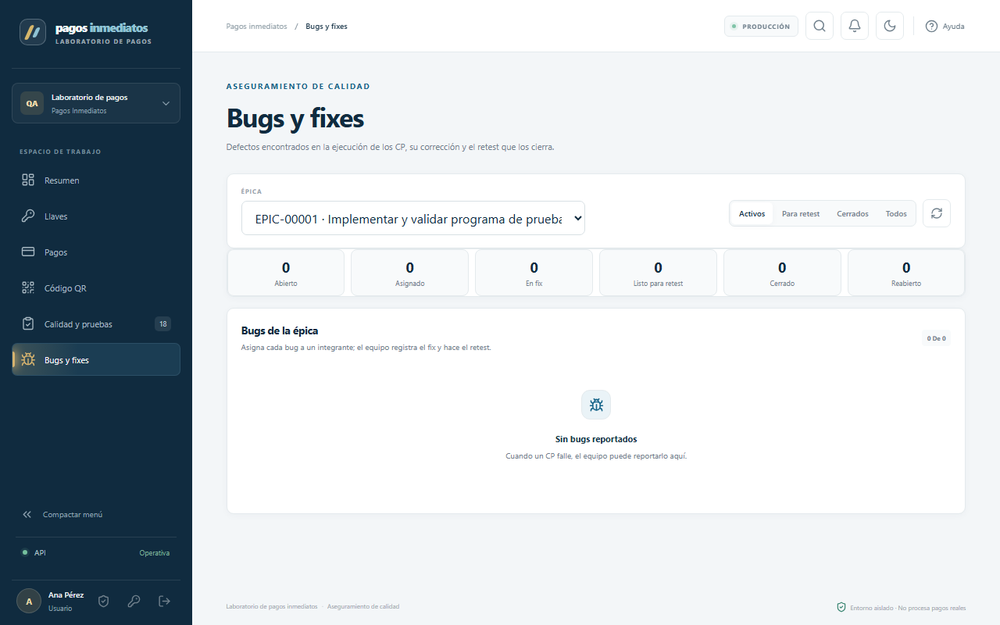

### 8.4 Reportar: resumen y estado del entorno

El **Resumen** completo muestra el avance de cada épica, tus tareas y el **estado del entorno**:
si la API está operativa, cuántas épicas tienes y los directorios y la liquidación simulada.

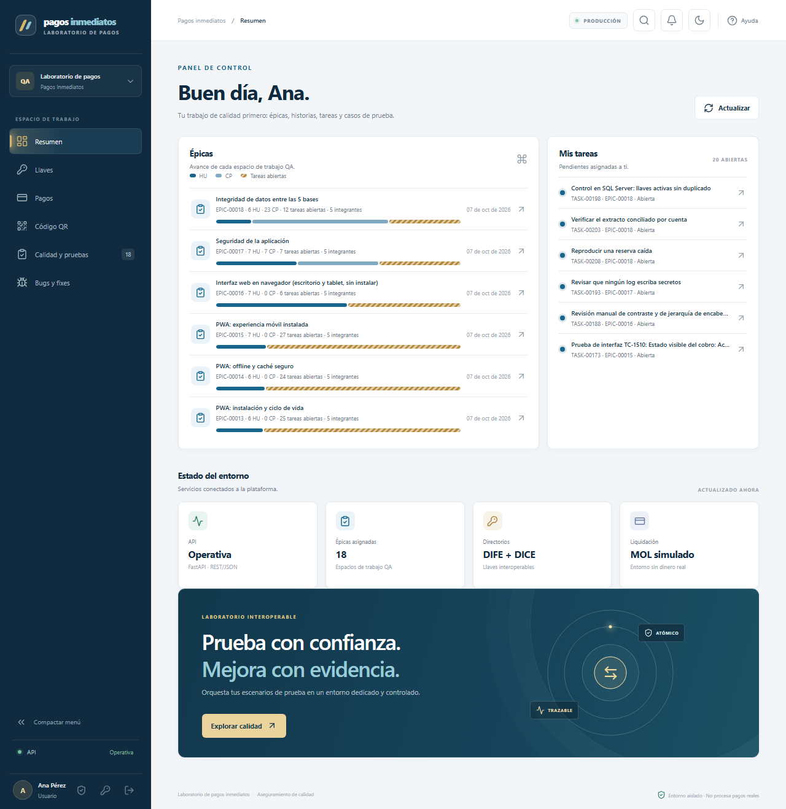

## 9. Gestión de perfil

Con la llave junto a tu nombre abres **Cambiar contraseña**:

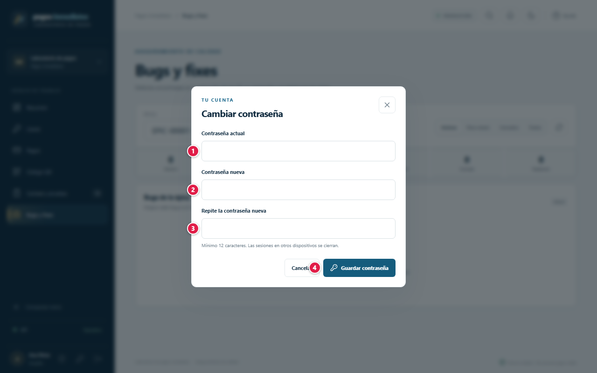

| # | Campo | Qué escribir |
|:-:|---|---|
| 1 | Contraseña actual | Tu contraseña de hoy |
| 2 | Contraseña nueva | Mínimo 12 caracteres |
| 3 | Repite la contraseña nueva | La misma contraseña nueva |
| 4 | Guardar contraseña | Guarda el cambio; las sesiones en otros dispositivos se cierran |

Con el escudo abres **Seguridad**, donde agregas el otro método de verificación y eliges el
preferido.

## 10. Mensajes frecuentes

| Mensaje | Qué significa | Qué hacer |
|---|---|---|
| Correo o contraseña incorrectos. | Los datos no coinciden | Revísalos o usa **¿Olvidaste tu contraseña?** |
| El código no es válido o venció. | El código ya no sirve | Pide uno nuevo con **Reenviar** |
| El código no es correcto. Revisa la hora de tu teléfono. | La hora del teléfono está desfasada | Activa la hora automática del teléfono |
| Demasiados códigos incorrectos. Espera 15 minutos. | El ingreso se bloqueó por seguridad | Espera 15 minutos |
| No tienes permisos para esta acción. | Tu rol no permite esa operación | Pide ayuda a un administrador |
| La llave ya está registrada. | Esa llave ya existe | Usa otra llave |
| La base de datos se está activando. Reintenta en unos segundos. | El servicio estaba en pausa | Espera unos segundos y repite |
| Esta dirección no tiene destino | La dirección no existe | Usa **Volver al laboratorio** |
| Sin conexión | Tu equipo no tiene internet | La pantalla reintenta sola |

| Página no encontrada | Sin conexión |
|:-:|:-:|
| 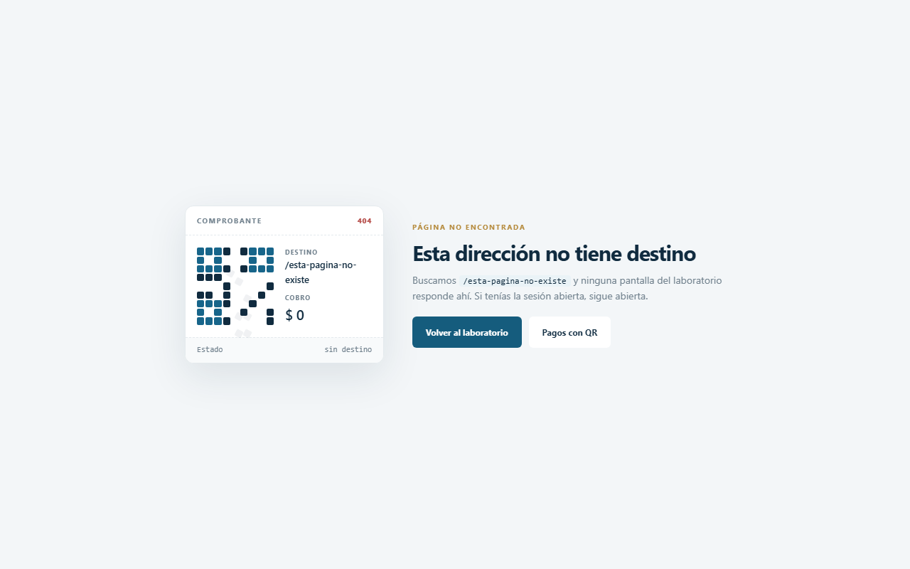 | 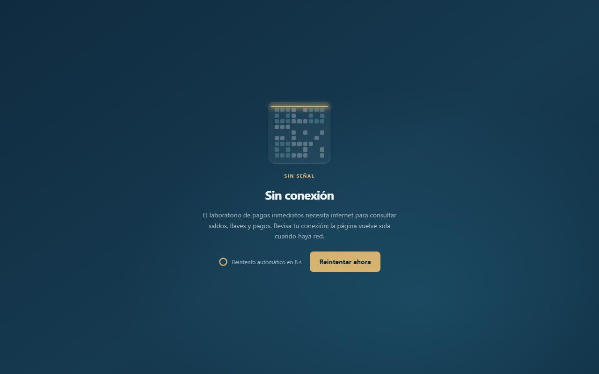 |

## 11. Preguntas frecuentes

**¿Se mueve dinero real?** No. Es un laboratorio: las cuentas, los saldos y la liquidación son
simulados.

**¿Por qué no veo épicas?** Las cuentas nuevas quedan pendientes hasta que un administrador las
asocia a una épica.

**¿Por qué la primera acción tarda un poco?** El servicio se pausa cuando nadie lo usa y tarda unos
segundos en reactivarse.

**¿Se puede instalar como aplicación?** Sí: en Chrome o Edge, **Instalar aplicación**; en iPhone,
Safari → **Compartir → Agregar a inicio**.

**¿Dónde pido ayuda o reporto un problema?** Telegram [@lfac6](https://t.me/lfac6), WhatsApp
[@carraian160](https://wa.me/carraian160) o [ariascluisf@hotmail.com](mailto:ariascluisf@hotmail.com).

## 12. Glosario

| Término | Qué significa |
|---|---|
| **CP (caso de prueba)** | Una solicitud a la API con el resultado esperado |
| **DIFE / DICE** | Directorio de llaves de cada entidad / directorio central |
| **Épica** | Un espacio de trabajo de QA con sus HU, CP y tareas |
| **HU (historia de usuario)** | Una necesidad descrita desde quien usa el sistema |
| **Idempotencia** | Repetir la misma operación no la duplica |
| **Llave** | Dato fácil de recordar (celular, correo…) que identifica una cuenta para recibir pagos |
| **SPBVI** | Entidad participante del ecosistema de pagos simulado |
| **Verificación en dos pasos** | Además de la contraseña, se pide un código que solo tú puedes recibir |
