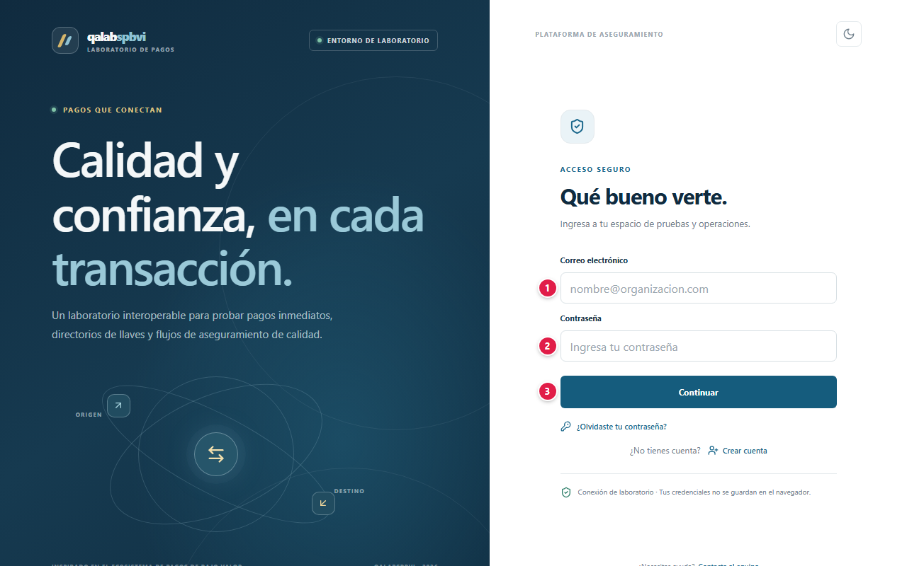
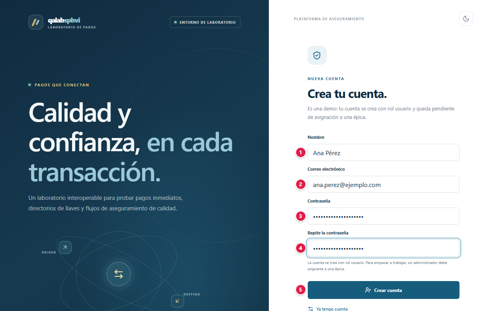
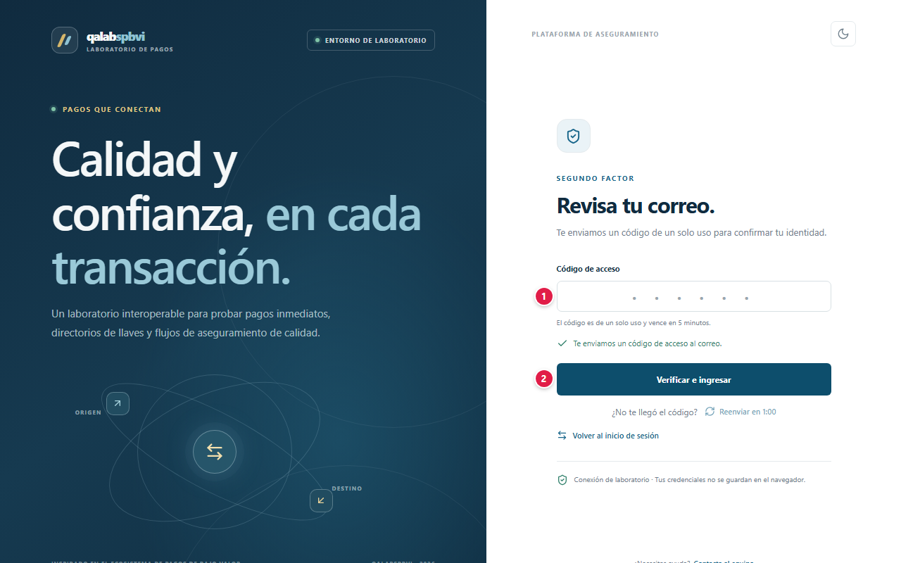
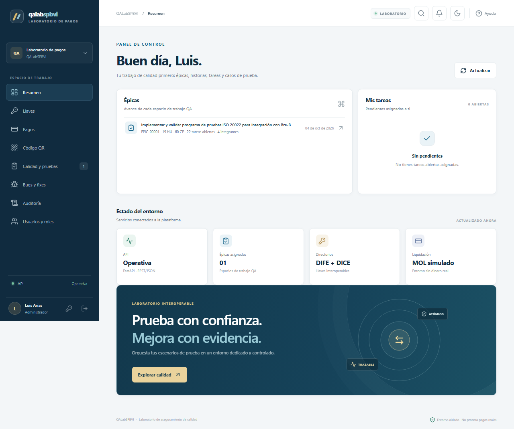
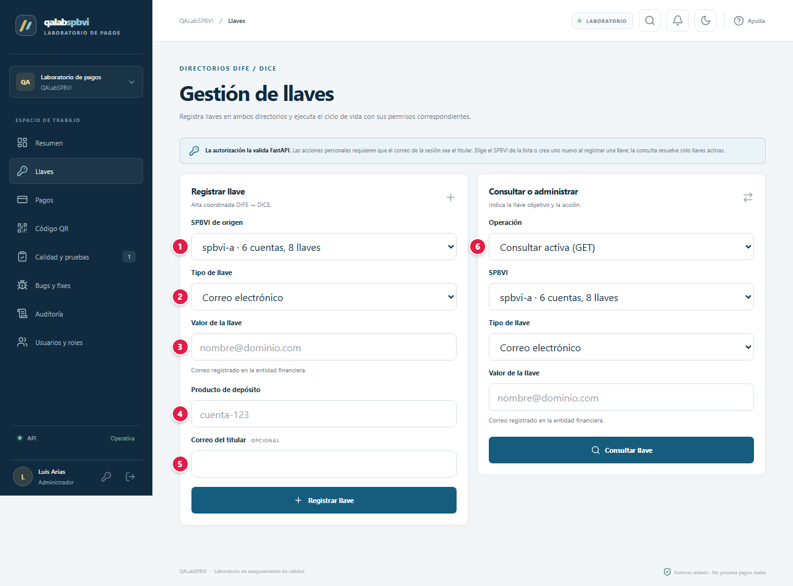
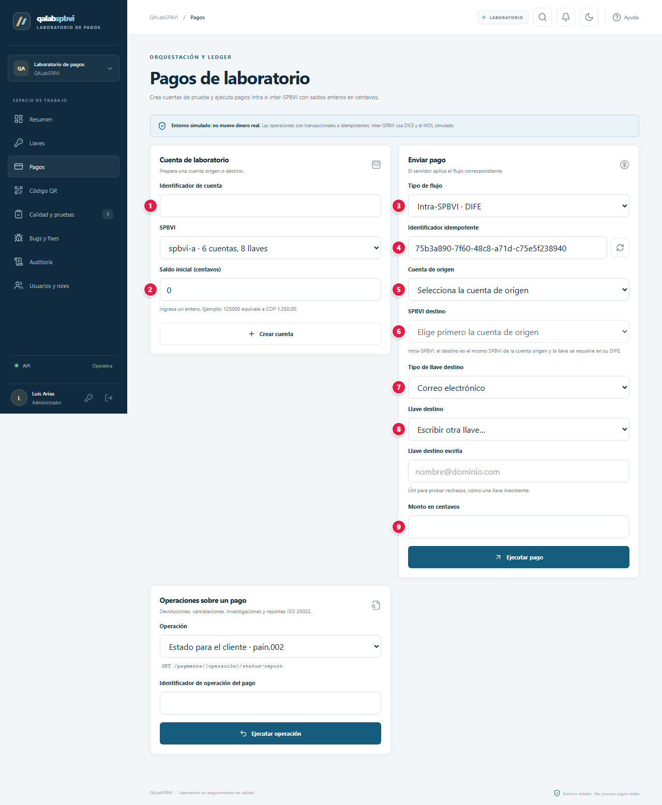
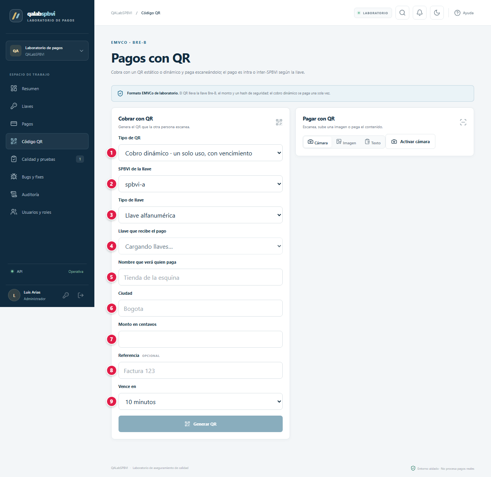
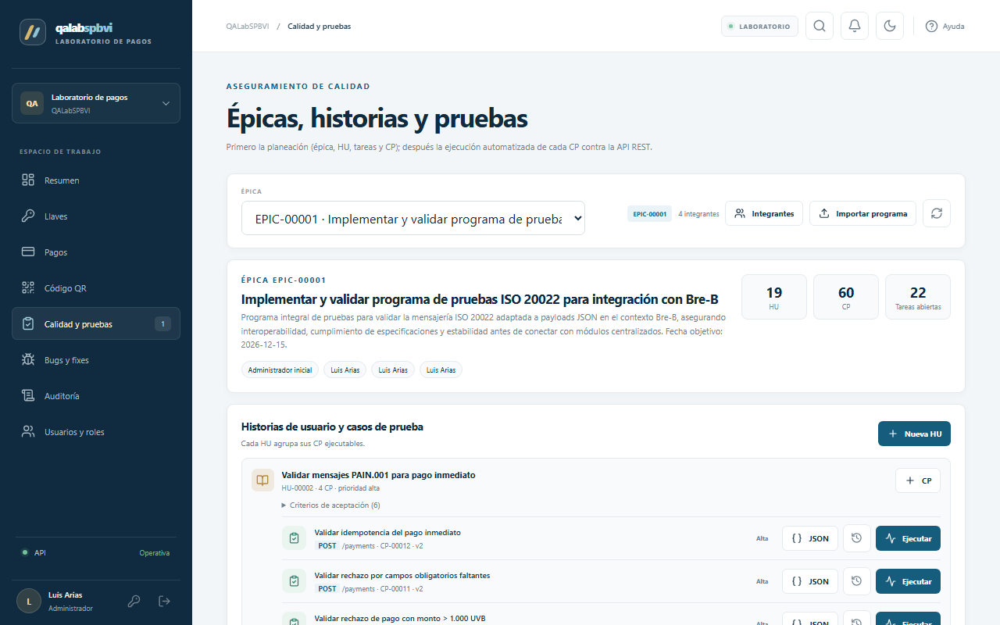
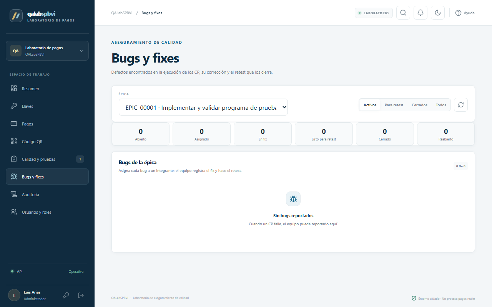

# 📘 Manual de usuario · QALabSPBVI

Guía para usar la plataforma paso a paso: qué significa cada campo, qué datos se ingresan y qué
protege la plataforma. Para la arquitectura, la referencia de la API y la instalación vuelve al
[README](../README.md).

**Demo:** [qalabspbvi-prod.vercel.app](https://qalabspbvi-prod.vercel.app)

## Contenido

1. [Proyecto: objetivos y alcances](#1-proyecto-objetivos-y-alcances)
2. [Glosario](#2-glosario)
3. [Plataformas, base de datos y servicios](#3-plataformas-base-de-datos-y-servicios)
4. [Paso a paso](#4-paso-a-paso)
5. [Seguridad: tu información protegida](#5-seguridad-tu-información-protegida)
6. [Agradecimientos](#6-agradecimientos)

---

## 1. Proyecto: objetivos y alcances

### Objetivo

Un laboratorio que **simula** un ecosistema de pagos inmediatos con llaves (celular, correo,
documento, `@alias`, código de comercio) y una plataforma QA tipo Jira para probarlo: épicas,
historias de usuario (HU), casos de prueba (CP) ejecutables con un clic, tareas, bugs y fixes.

> **No mueve dinero real** ni se conecta a ninguna infraestructura de pagos. Todos los montos se
> escriben en **centavos** (125000 = COP 1.250,00).

### Alcance: qué necesitas y qué esperar

- Solo necesitas un navegador; también se instala como app (Chrome o Edge: menú → "Instalar app";
  iPhone o iPad: Safari → Compartir → "Agregar a inicio").
- Necesitas acceso a tu correo: cada inicio de sesión pide un **código de 6 dígitos** que llega
  por correo.
- Las bases se pausan sin uso. Mientras se activan, los botones de ejecutar quedan deshabilitados y
  se habilitan solos cuando están listas.
- Una cuenta nueva tiene rol `usuario` y empieza a trabajar cuando un administrador la **asocia a
  una épica**.

### Límites

- Es un **laboratorio**: no registres llaves, documentos ni cuentas reales.
- Los integrantes de una épica ven las ejecuciones y los avisos con tu nombre y correo.
- Ejecutar un CP o registrar un bug envía un aviso por correo a toda la épica.

## 2. Glosario

Palabras técnicas que aparecen en este manual, explicadas en lenguaje simple.

| Término | Qué significa |
|---|---|
| **Administrador** | Cuenta con permisos para gestionar usuarios y configuraciones de la aplicación. |
| **API** | Puerta de entrada de un programa para que otros programas le pidan o le envíen datos. |
| **Backend** | La parte de la aplicación que trabaja "detrás": procesa lo que envías y habla con la base de datos. |
| **Base de datos** | Lugar donde la aplicación guarda la información de forma ordenada y permanente. |
| **Caso de prueba** | Pasos y resultado esperado para comprobar que una función de un sistema trabaja bien. |
| **Cifrado / TLS / HTTPS** | Protección que codifica la información mientras viaja, para que nadie en el camino pueda leerla. |
| **Contraseña cifrada (hash)** | La contraseña no se guarda tal cual, sino como una "huella" de la que no se puede recuperar el texto original. |
| **Cookie** | Pequeño dato que el navegador guarda para recordar tu sesión en ese sitio. |
| **Código QR** | Cuadro de puntos que el celular lee con la cámara para abrir un enlace o un cobro. |
| **Defecto (bug)** | Error encontrado al probar: el sistema no hace lo que debería. |
| **Despliegue** | Publicar una nueva versión de la aplicación para que esté disponible en internet. |
| **Insignia (badge)** | Pequeña imagen que muestra un estado en vivo, por ejemplo en un README de GitHub. |
| **Liquidación** | Paso final de un pago en el que el dinero se mueve efectivamente de una cuenta a otra. |
| **Llave (alias de pago)** | Dato fácil de recordar (como @usuario o un número) que identifica una cuenta para recibir pagos. |
| **MFA (segundo factor)** | Verificación adicional a la contraseña, como un código de 6 dígitos, para confirmar que eres tú. |
| **Navegador** | Programa con el que abres páginas web: Chrome, Edge, Firefox, Safari. |
| **Nube** | Servidores de una empresa (Amazon, Microsoft, Google, Oracle…) donde la aplicación funciona sin depender de un computador propio. |
| **Rate limit (límite de intentos)** | Tope de intentos en poco tiempo, para frenar a quien intenta adivinar contraseñas. |
| **REST** | Forma estándar de organizar una API usando direcciones web y métodos como GET o POST. |
| **Rol** | Tipo de cuenta que define qué puede hacer cada persona (por ejemplo, usuario o administrador). |
| **Servidor** | Computador en la nube que atiende las peticiones de la aplicación. |
| **Sesión** | El tiempo en que la aplicación te reconoce después de iniciar sesión, sin pedirte la contraseña de nuevo. |
| **Tema claro / oscuro** | Combinación de colores de la interfaz; puedes elegir la clara o la oscura. |
| **Token** | Credencial temporal que la aplicación te entrega al iniciar sesión, en lugar de enviar tu contraseña en cada paso. |
| **Variables de entorno / secretos** | Claves y contraseñas internas de la aplicación, guardadas fuera del código para que no queden expuestas. |

## 3. Plataformas, base de datos y servicios

Qué servicio de nube, base de datos o API usa el proyecto y para qué sirve cada uno.

| Plataforma | Tipo | Qué hace en el proyecto |
|---|---|---|
|  | Nube | Publica la interfaz React y reenvía `/api/*` a la API, de modo que el navegador ve un solo dominio y las cookies siguen siendo `SameSite=Strict`. Se publica sola en cada push. |
|  | Nube | Ejecuta la API FastAPI: autenticación con MFA, llaves DIFE/DICE, pagos intra e inter-SPBVI, MOL simulado, gestión QA y el ejecutor de CP. Escala a cero sin uso. |
|  | Base de datos | DIFE: directorio federado de llaves de cada SPBVI y auditoría de su ciclo de vida. Resuelve las llaves de los pagos **intra-SPBVI**. |
|  | Gestión de secretos | Guarda las cadenas de conexión y claves de la API, que las lee con identidad administrada. |
|  | Base de datos | DICE en Autonomous Database (OCI): índice central de llaves con unicidad global. Resuelve las llaves de los pagos **inter-SPBVI**. |
|  | Base de datos | PostgreSQL de cuentas, ledger, pagos, usuarios y sesiones; ahí liquidan los pagos intra e inter. En una base aparte guarda el registro de solicitudes que alimenta la auditoría. |
|  | Base de datos | Artefactos QA: épicas, HU, CP con su JSON versionado, ejecuciones, bugs, fixes y la lista de llaves de cada épica. |
| -4479A1?style=for-the-badge&logo=mysql&logoColor=white) | Base de datos | MySQL de los cobros con QR: cada cobro dinámico con su monto, vencimiento y estado. Escala a cero sin uso. |
|  | Nube | Cola SQS con DLQ y Lambda que entrega por Brevo los avisos QA. La API solo puede enviar a la cola; la API key de Brevo vive en SSM Parameter Store. |
|  | Nube | Gateway ISO 20022: servicio aparte que genera los pacs.008 / pacs.002 de laboratorio. Se suspende sin uso; mientras despierta, la API los genera en proceso. |
|  | API / servicio externo | Envía el código MFA, la bienvenida y los avisos QA. |
|  | Código y CI/CD | Código, CI/CD con Actions (OIDC hacia Azure y AWS, sin claves guardadas) e imágenes públicas en Container Registry. |

## 4. Paso a paso

### 4.1 Iniciar sesión

| # | Campo | Qué escribir |
|:-:|---|---|
| 1 | Correo electrónico | El correo de tu cuenta |
| 2 | Contraseña | Tu contraseña |
| 3 | Continuar | Valida la contraseña y envía el código a tu correo |

Si los datos no coinciden, el mensaje es siempre «Correo o contraseña incorrectos», exista o no la
cuenta. **¿Olvidaste tu contraseña?** envía un código de un solo uso para definir una nueva.

### 4.2 Crear una cuenta

| # | Campo | Qué escribir | Reglas |
|:-:|---|---|---|
| 1 | Nombre | Tu nombre visible en la plataforma | Obligatorio |
| 2 | Correo electrónico | Donde recibirás los códigos y avisos | Único |
| 3 | Contraseña | Tu contraseña | Mínimo **12 caracteres** |
| 4 | Repite la contraseña | La misma contraseña | Debe coincidir |
| 5 | Crear cuenta | Botón | Crea la cuenta con rol `usuario` |

### 4.3 Código de acceso (MFA)

| # | Campo | Qué escribir |
|:-:|---|---|
| 1 | Código de acceso | Los 6 dígitos que llegaron a tu correo. Vence a los **5 minutos** y sirve una sola vez |
| 2 | Verificar e ingresar | Entra a la plataforma |

**¿No te llegó el código?** pide otro sin volver a escribir la contraseña.

### 4.4 Resumen

Muestra tus épicas con su avance, tus tareas pendientes y el **Estado del entorno** (API,
directorios DIFE + DICE y liquidación simulada). El menú lateral (inferior en el celular) lleva a
cada sección; arriba a la derecha están búsqueda, notificaciones, tema y ayuda.

### 4.5 Llaves

**Registrar llave**

| # | Campo | Qué escribir |
|:-:|---|---|
| 1 | SPBVI de origen | La entidad simulada donde se registra la llave (o **Nuevo SPBVI…**) |
| 2 | Tipo de llave | Documento, celular, correo, alfanumérica (`@`) o código de comercio |
| 3 | Valor de la llave | La llave en el formato del tipo (ver tabla) |
| 4 | Producto de depósito | La cuenta de laboratorio que recibirá los pagos |
| 5 | Correo del titular | Opcional: quién puede hacer acciones personales sobre la llave |

**Consultar o administrar**

| # | Campo | Qué escribir |
|:-:|---|---|
| 6 | Operación | Consultar, suspender o reactivar (personal o administrativa), asignar o cambiar titular, o eliminar; luego el SPBVI, el tipo y el valor de la llave |

Formatos de llave (supuestos del laboratorio):

| Tipo | Ejemplo | Regla |
|---|---|---|
| Documento | `1023456789` | 5 a 15 dígitos |
| Celular | `3001234567` | 10 dígitos que inician en 3; se acepta `+57` |
| Correo | `nombre@dominio.com` | Se guarda en minúsculas |
| Alfanumérica | `@ana2026` | `@` + 3 a 20 letras o números |
| Código de comercio | `0012345` | 4 a 10 dígitos |

### 4.6 Pagos

**Cuenta de laboratorio** (solo `admin` y `administrador`)

| # | Campo | Qué escribir |
|:-:|---|---|
| 1 | Identificador de cuenta | Nombre de la cuenta, por ejemplo `cuenta-ana` (y el **SPBVI** al que pertenece) |
| 2 | Saldo inicial (centavos) | Saldo de partida, en centavos |

**Enviar pago**

| # | Campo | Qué escribir |
|:-:|---|---|
| 3 | Tipo de flujo | **Intra-SPBVI · DIFE** (misma entidad) o **Inter-SPBVI · DICE + MOL** (entre entidades) |
| 4 | Identificador idempotente | Se genera solo; repetirlo no duplica el pago. ↻ genera otro |
| 5 | Cuenta de origen | La cuenta que paga |
| 6 | SPBVI destino | En intra es el mismo de la cuenta origen; en inter, otro |
| 7 | Tipo de llave destino | Tipo de la llave que recibe |
| 8 | Llave destino | Una llave de la lista, o **Escribir otra llave…** para probar rechazos |
| 9 | Monto en centavos | Máximo **1.000 UVB** por operación |

**Operaciones sobre un pago:** con el identificador de operación consultas su estado, pides una
devolución (pacs.004), solicitas una cancelación (camt.056) o ves notificaciones (camt.054).

### 4.7 Código QR

**Cobrar con QR**

| # | Campo | Qué escribir |
|:-:|---|---|
| 1 | Tipo de QR | Cobro dinámico (un solo uso, con vencimiento), estático, o estático con monto fijo |
| 2 | SPBVI de la llave | Entidad donde está la llave que recibe |
| 3 | Tipo de llave | Tipo de esa llave |
| 4 | Llave que recibe el pago | Una llave confirmada (un `usuario` solo puede usar llaves de las que es titular) |
| 5 | Nombre que verá quien paga | Nombre del comercio |
| 6 | Ciudad | Ciudad que muestra el QR |
| 7 | Monto en centavos | Solo en dinámico y en estático con monto fijo |
| 8 | Referencia | Opcional, por ejemplo "Factura 123" |
| 9 | Vence en | 5, 10 o 30 minutos, o 1 hora (solo dinámico) |

Pulsa **Generar QR**. **Pagar con QR** lee el código con la **Cámara**, desde una **Imagen** o
pegando su **Texto**; luego eliges la cuenta de origen y pulsas **Pagar**. Un QR alterado se
rechaza por CRC o firma sin mover dinero.

### 4.8 Calidad y pruebas

1. Elige la **Épica**: aparecen sus HU con sus CP, las **Tareas** y las **Llaves de la épica**.
2. En un CP, **Ejecutar** envía la solicitud REST y muestra método, URL, solicitud, código,
   respuesta, veredicto y validación del contrato OpenAPI.
3. **Editar JSON del caso** pide el **Motivo del cambio** y guarda la versión anterior en el
   **Historial de versiones**.

### 4.9 Bugs y fixes

**Reportar bug** pide **Título**, **Descripción**, **Severidad**, **Caso de prueba** y, si aplica,
**Ejecución**. El bug sigue el flujo `abierto → asignado → en_fix → listo_para_retest → cerrado`
(o `reabierto` si falla el retest), y **Registrar fix** documenta **Qué se corrigió**.

### 4.10 Roles

| Acción | `admin` | `administrador` | `usuario` |
|---|:-:|:-:|:-:|
| Crear épicas | ✓ | | |
| Asociar integrantes a épicas y asignar tareas | ✓ | ✓ | |
| Crear HU, CP e importar programas | | ✓ | |
| Ejecutar CP, editar su JSON y avanzar tareas (si integra la épica) | ✓ | ✓ | ✓ |
| Registrar bugs y fixes | | | ✓ |
| Crear cuentas de laboratorio y administrar cualquier llave | ✓ | ✓ | Solo acciones personales sobre sus llaves |
| Ver Auditoría y Usuarios y roles | ✓ | ✓ | |

### 4.11 Preguntas frecuentes

**Creé mi cuenta y no veo épicas.** Un administrador debe asociarte a una épica.

**¿Por qué el botón Ejecutar está gris?** Las bases se están activando después de un período sin
uso; se habilita solo en uno o dos minutos.

**¿Qué diferencia hay entre intra e inter-SPBVI?** Intra: origen y destino en la misma entidad; la
llave se resuelve en su directorio (DIFE). Inter: entidades distintas; la llave se resuelve en el
directorio central (DICE) y se liquida en el MOL simulado.

## 5. Seguridad: tu información protegida

Tu confianza es lo primero: la plataforma solo pide los datos necesarios para funcionar, los protege y no los comparte con terceros. Esto es lo que se guarda y cómo se protege.

### Qué datos se guardan y dónde

| Dato | Para qué se usa | Dónde se guarda | Cómo se protege |
|---|---|---|---|
| Nombre y correo | Identificarte y enviarte códigos y avisos | PostgreSQL (Neon) | Visibles para los integrantes de tus épicas en los avisos |
| Contraseña | Iniciar sesión | PostgreSQL, **solo su huella Argon2id** | No se puede leer ni recuperar |
| Códigos MFA y de recuperación | Segundo factor | PostgreSQL, con vencimiento y límite de intentos | Un solo uso |
| Llaves de pago | Simular el directorio | Azure SQL (DIFE) y Oracle ADB (DICE) | Datos de laboratorio |
| Cuentas, pagos y ledger | Simular la liquidación | PostgreSQL (Neon) | Sin dinero real |
| Cobros QR | Pagos con QR | MySQL (TiDB Cloud), con TLS | Hash HMAC-SHA256 en el QR |
| Épicas, HU, CP, ejecuciones, bugs | Trabajo QA | MongoDB Atlas | Visibles para los integrantes de la épica |
| Registro de solicitudes | Auditoría | PostgreSQL aparte | Solo `admin` y `administrador` |
| Sesión | Mantenerte conectado | Cookies `SameSite=Strict` | Vencen por inactividad y por tiempo absoluto |

### Cómo se protege tu información

Comprobado en el código del proyecto (`app/core/security.py`, `app/domains/auth/`):

- **Contraseñas con Argon2id**, el algoritmo recomendado actualmente para guardar contraseñas.
- **Segundo factor obligatorio:** código por correo de 6 dígitos que vence en 5 minutos, con
  máximo 5 intentos.
- **Límites contra fuerza bruta:** 10 intentos fallidos por correo cada 15 minutos; 5 registros por
  conexión cada hora; recuperación con código de 10 minutos, 5 intentos y máximo 3 códigos cada 15
  minutos.
- **Mensaje único** ante credenciales inválidas, exista o no la cuenta.
- **Sesiones con doble vencimiento:** 30 minutos de inactividad y 8 horas como máximo. Cambiar la
  contraseña cierra las demás sesiones; desactivar una cuenta cierra todas las suyas.
- **Protección CSRF** (cookie más encabezado `x-csrf-token`) y cookies `SameSite=Strict`: la web
  y la API se ven como un solo dominio.
- **Roles validados en el servidor:** la interfaz solo oculta lo que el backend igual rechazaría.
- **Pagos consistentes:** idempotencia por identificador, límite por operación, ledger que siempre
  suma cero y QR firmados que se rechazan si se alteran.
- **Correos sin datos sensibles:** nunca incluyen credenciales, tokens ni datos de pagos (salvo el
  propio código MFA, con su aviso de no compartirlo).
- **Secretos en gestores:** Azure Key Vault (leído con identidad administrada) y AWS SSM; cada base
  tiene credenciales propias y exige TLS. El despliegue usa OIDC, sin claves guardadas.
- **Trazabilidad:** cada solicitud queda registrada con identificador de correlación, usuario y
  operación.

## 6. Agradecimientos

A mi familia, por su apoyo incondicional, su paciencia y por creer en cada proyecto incluso cuando apenas era una idea. Este trabajo también es de ustedes.

Y a ti, que usas esta plataforma: cada prueba, comentario y sugerencia ayuda a que siga mejorando.
